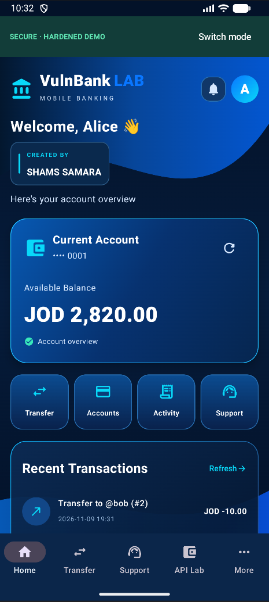
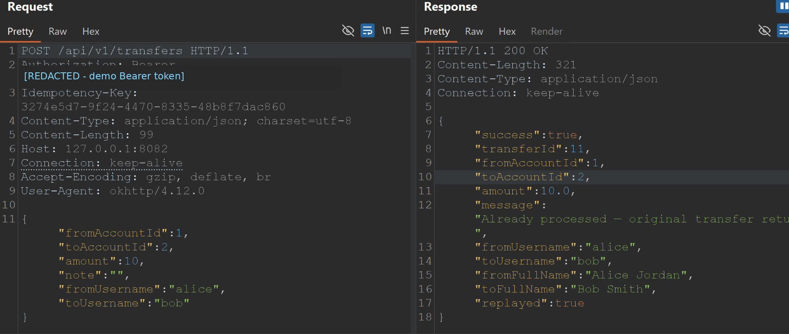

# 🏦 VulnBank LAB

### Android Banking Security Lab | Vulnerable vs. Hardened API Testing

**Developed by SHAMS SAMARA**

VulnBank LAB is an educational Android banking simulation for hands-on **mobile application security, API penetration testing, business-logic analysis, and secure-coding comparisons**. It uses **Kotlin, Jetpack Compose, Ktor, PostgreSQL, Docker Compose, OkHttp, and Burp Suite** to demonstrate how banking vulnerabilities work and how selected server-side controls mitigate them.

Users can choose between an intentionally insecure **Vulnerable Mode** and a separate **Secure Mode** (a hardened comparison demo). Both contain fictional customers, balances, transactions, support tickets, and simulated transfers.

> [!WARNING]
> **INTENTIONALLY INSECURE — ISOLATED LOCAL TRAINING ONLY.** All users, accounts, payments, credentials, and API keys are synthetic. Never connect this project to real financial systems or expose its endpoints to the public internet. **Secure Mode is not audited or production-ready**; both modes intentionally use unencrypted local HTTP to support Burp Suite demonstrations.

---

## 📱 Application Screenshots

### Login and Banking Dashboard

| Login | Dashboard |
|:---:|:---:|
|  |  |

### Transfers and Transaction History

| Transfer Money | Recent Transactions |
|:---:|:---:|
|  |  |

### Security Modes and API Lab

| Secure Mode Dashboard | API Testing Lab |
|:---:|:---:|
|  |  |

### Burp Suite — Secure Transaction Replay

<p align="center">
  
</p>

*The replayed request returns `"replayed": true` and the original transfer ID without a second debit. The demo Bearer token in the screenshot is redacted.*

> GitHub renders the images above from `docs/screenshots/`. If an image is missing, verify its exact filename and that the file is committed to the repository's current branch.


---

## ✨ Features

- Native **Kotlin / Jetpack Compose** UI with a navy-blue banking theme, custom logo, loading motion, and smooth transitions.
- Authentication, account overview, JOD balances, synthetic transaction history, and searchable recipients.
- Simulated money transfers, customer support, and an integrated API testing interface.
- Startup selection between **Vulnerable** and **Secure** training environments.
- A **Transaction Replay / Idempotency** exercise with intentionally different behavior in each environment.
- Traffic inspection using **Burp Suite** without Frida or certificate installation in the local HTTP lab.
- Separate Ktor services, isolated PostgreSQL databases, and repeatable verification scripts.
- Visible creator credit: **CREATED BY SHAMS SAMARA**.

The seed data includes **12 fictional customers**. A recipient may be displayed as `Bob Smith · @bob · Account #2`.

## 🔐 Vulnerable vs. Secure Mode

The two modes are selected at application startup and use separate backend services and database storage. The Secure implementation demonstrates specific defenses; it does **not** claim the application is free of every vulnerability.

| Security scenario | 🟠 Vulnerable Mode | 🟢 Secure Mode |
|---|---|---|
| Login and SQL injection | Deliberately injectable login | Parameterized queries and hardened authentication |
| User and account authorization | BOLA / IDOR training | Session authentication and account-ownership checks |
| Customer API | Embedded demonstration API key | Session-based access control |
| Customer support | Unsafe HTML/WebView scenario | Safer display of untrusted content |
| Transfer source account | Missing sender-ownership verification | Server-side ownership enforcement |
| Duplicate transfer replay | Duplicate requests can debit twice | Idempotency key prevents repeat debit |
| Changed payload, same key | No idempotency safeguard | Request rejected without another debit |
| Simultaneous duplicate requests | Not established by the test suite | Tested to return one transaction and one debit |

### Vulnerability research topics

- **SQL Injection** — authentication bypass and prepared statements.
- **BOLA / IDOR** — object ownership and access-control failures.
- **Stored XSS** — rendering untrusted support-ticket content in a WebView.
- **Hardcoded API Keys** — extracting client-side demo credentials.
- **Business Logic Abuse** — changing the source account on a fictional transfer.
- **Transaction Replay** — duplicate debits when idempotency is missing.
- **Concurrent Replay** — demonstrating how the hardened service handles duplicate requests arriving at the same time.

---

## 💳 Transaction Replay & Idempotency Lab

**Scenario:** Alice intends to transfer **5 JOD** to Bob. The same HTTP request is sent twice with the same `Idempotency-Key`, as might happen with an application retry or a request replay.

**Verified local test results:**

| Test | Vulnerable Mode | Secure Mode |
|---|---|---|
| Request sent twice | Two transactions | Original transaction result reused |
| Alice's total debit | **10.00 JOD** | **5.00 JOD** |
| Transfer IDs in one recorded run | `14`, `15` | `1`, `1` |
| Reuse key with modified transfer | Not protected | Rejected; balance unchanged |
| Two simultaneous identical retries | Not verified in vulnerable mode | Same transfer ID; one debit |

The transaction IDs are from a specific successful test run; new installations will have different IDs. The results establish only the tested behavior, not general security certification.

### Run the automated security checks

Check both environments without executing replay transfers:

```powershell
python .\scripts\verify_dual_mode.py
```

Run the sequential replay test (**changes fictional balances**):

```powershell
python .\scripts\verify_dual_mode.py --run-replay
```

Run the concurrent replay test (**changes fictional balances**):

```powershell
python .\scripts\verify_dual_mode.py --run-concurrent
```

You can also inspect `POST /api/v1/transfers` in **Burp Suite → HTTP history**, send the original request to **Repeater**, and replay it with the same `Idempotency-Key`. Keep the request body identical when evaluating duplicate handling.

---

## 🏗️ Local Architecture

```text
                         Android Emulator
                       VulnBank LAB Android
                               |
                 +-------------+-------------+
                 |                           |
           Vulnerable Mode               Secure Mode
                 |                           |
       Burp 10.0.2.2:8081         Burp 10.0.2.2:8083
                 |                           |
       Ktor 127.0.0.1:8080        Ktor 127.0.0.1:8082
                 |                           |
       PostgreSQL (db)            PostgreSQL (db_secure)
       isolated vulnnet          isolated securenet
```

| Component | Vulnerable | Secure |
|---|---|---|
| Android explicit proxy | `10.0.2.2:8081` | `10.0.2.2:8083` |
| Burp listener on Windows | `127.0.0.1:8081` | `127.0.0.1:8083` |
| Ktor backend on Windows | `127.0.0.1:8080` | `127.0.0.1:8082` |
| PostgreSQL | `db` (host mapping `127.0.0.1:5433`) | `db_secure` (internal Docker access) |
| Network | `vulnnet` | `securenet` |

`10.0.2.2` is the Android Emulator's alias for the host computer. The dual-proxy configuration requires the corresponding OkHttp settings in `BankApi.kt` and two running Burp listeners. The project uses **plain local HTTP** intentionally and does not require Frida or Burp CA certificates.

**The Burp listeners should use ordinary HTTP proxying, without a forced host/port redirect, when the Android client sends the correct destination URL.**

## 🛠️ Technology Stack

| Layer | Technology |
|---|---|
| Android | Kotlin, Jetpack Compose, Android Studio |
| HTTP | OkHttp, explicit HTTP proxy |
| Backend | Kotlin Ktor REST APIs |
| Database | PostgreSQL |
| Containerization | Docker Compose |
| Verification | Python 3, Burp Suite Repeater |
| Build | Gradle 8.14; JDK 17 or 21 recommended |

## 📁 Repository Layout

```text
Vuln_Bank_LAB/
├── app/                         # Android app (Kotlin + Compose)
│   └── src/main/
├── server/                      # Ktor vulnerable and hardened routes
│   └── src/main/kotlin/
├── db/
│   ├── init.sql                 # Vulnerable demo database
│   └── init_secure.sql          # Hardened demo database
├── docs/
│   └── screenshots/             # GitHub screenshot gallery
├── scripts/
│   └── verify_dual_mode.py      # Verification and replay tests
├── compose.yaml                 # Four services, two Docker networks
├── build.gradle.kts
├── settings.gradle.kts
└── README.md
```

The project documentation includes `docs/DUAL_MODE_REPLAY_AR.md`, `docs/TRANSFER_BURP_AR.md`, `docs/BURP_NO_CERT_AR.md`, and `docs/API_REFERENCE.md`.

---

## 🚀 Getting Started

### Requirements

- Windows 10/11 with **Docker Desktop**, Docker Compose, and **Android Studio**.
- Android SDK with a running Android Emulator.
- **Gradle-compatible JDK 17 or 21** selected under Android Studio's Gradle settings.
- **Burp Suite** for traffic interception.
- Python 3 for the optional validation scripts.
- Internet access for initial dependencies and Docker images.

### 1. Clone and start the lab

```powershell
git clone https://github.com/shamssamara/Vuln_Bank_LAB.git
cd Vuln_Bank_LAB

docker compose up -d --build
docker compose ps
```

Expected services are `db`, `server`, `db_secure`, and `server_secure`. **Do not run `docker compose down -v` unless you intend to delete both synthetic database volumes.**

### 2. Verify the two backends

```powershell
curl.exe --noproxy "*" http://127.0.0.1:8080/health
curl.exe --noproxy "*" http://127.0.0.1:8082/health
python .\scripts\verify_dual_mode.py
```

Expected health response fields include `"backendVersion": "2026.11-dual-mode-replay"` and `"securityMode": "vulnerable"` or `"securityMode": "secure"`, respectively.

### 3. Configure Burp Suite

Under **Proxy → Proxy settings → Proxy listeners**, create two listeners:

- **Vulnerable:** bind to `127.0.0.1:8081`.
- **Secure:** bind to `127.0.0.1:8083`.

Set **Intercept off** for normal operation; enable it only when you need to pause a request. Use HTTP history and Repeater to test the synthetic APIs. No device-wide Android proxy is necessary if the app's explicit OkHttp proxy configuration is installed.

### 4. Run Android

Open the **repository root** in Android Studio, sync Gradle, select a running emulator and press **Run**. Choose **Vulnerable** or **Secure** on the startup screen.

Demo login:

```text
Username: alice
Password: password123
```

These credentials are **training-only**. A successful Android build does not require rebuilding Docker unless the server code has changed.

### 5. Daily startup and shutdown

If Docker Desktop starts automatically with Windows and the services use `restart: unless-stopped`, containers can restart when Docker starts. Otherwise:

```powershell
docker compose up -d
```

To stop without deleting balances and tickets:

```powershell
docker compose stop
```

### Windows Buildx troubleshooting

Some Windows Docker Compose / Buildx combinations may report `additional privileges requested` while reading `server/Dockerfile`. For a **trusted local checkout only**, the following temporary workaround has been used:

```powershell
$env:BUILDX_BAKE_ENTITLEMENTS_FS = "0"
docker compose build server server_secure
docker compose up -d --no-build --force-recreate server server_secure
Remove-Item Env:BUILDX_BAKE_ENTITLEMENTS_FS
```

Prefer updating Docker Desktop/Compose when a fixed version is available. This environment variable should not be set globally for unrelated builds.

---

## 📡 Selected API Endpoints

| Method | Endpoint | Purpose |
|---|---|---|
| GET | `/health` | Backend identity and status |
| POST | `/api/v1/auth/login` | Demo login; SQLi comparison |
| POST | `/api/v1/auth/logout` | Secure session logout |
| GET | `/api/v1/recipients` | Recipient directory |
| GET | `/api/v1/accounts/{id}` | Account lookup; BOLA comparison |
| GET | `/api/v1/transactions?account_id={id}` | Transaction history |
| POST | `/api/v1/transfers` | Synthetic transfer; replay and idempotency testing |
| GET | `/api/v1/customers` | Demo customer API |
| POST | `/api/v1/support` | Submit a support ticket |
| GET | `/api/v1/support` | Read support tickets |

The available authentication/authorization requirements differ by security mode. Refer to `docs/API_REFERENCE.md` and the route implementations for exact request and response contracts.

## 🔒 Security Lessons

| Vulnerability or flaw | Recommended production defense |
|---|---|
| SQL injection | Parameterized queries and input handling |
| BOLA / IDOR | Server-side object-level authorization |
| Stored XSS | Safe rendering and context-appropriate encoding |
| Hardcoded secrets | Avoid sensitive client-side credentials |
| Unauthorized transfers | Verify authenticated sender ownership |
| Duplicate processing | Persistent idempotency keys and atomic transactions |
| Concurrent replay | Concurrency-safe duplicate detection |
| Insecure transport | HTTPS/TLS and appropriate production transport security |

The hardened lab demonstrates selected controls but is not a substitute for professional security review, threat modeling, penetration testing, or production hardening.

---

## ⚠️ Responsible Use

This project is intended for authorized local experiments, academic demonstrations, secure development training, and cybersecurity education. Do not deploy the intentionally vulnerable services publicly, use real credentials, or connect fictional payments to external financial infrastructure.

## 👨‍💻 Author and Copyright

**SHAMS SAMARA**  
*Cybersecurity · Mobile Security · API Penetration Testing*

**© 2026 Shams Samara.** Original authored material belongs to its respective copyright holder. Check the repository's `LICENSE` and any applicable component licenses for permissions; third-party dependencies remain under their respective terms. A copyright notice does not override the permissions granted by a published open-source license.

**VulnBank LAB — Learn by Testing. Understand by Exploiting. Secure by Design.**
