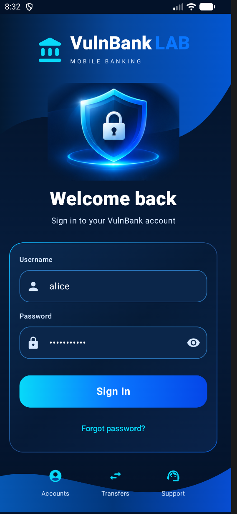
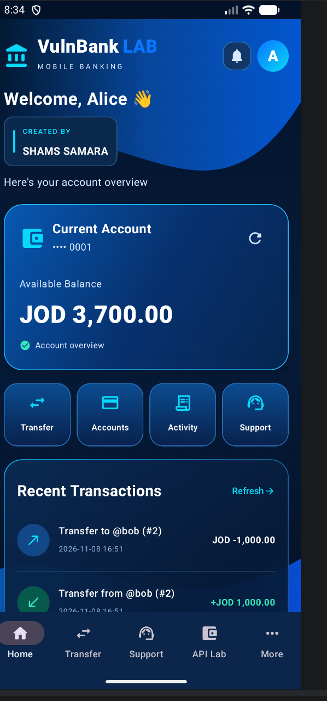
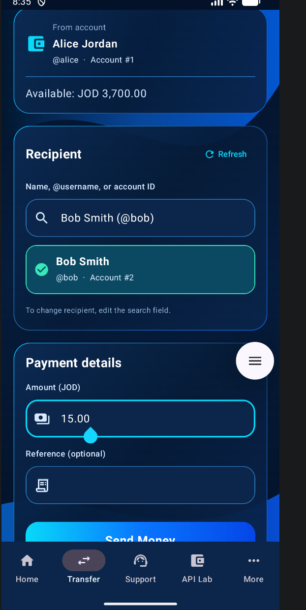
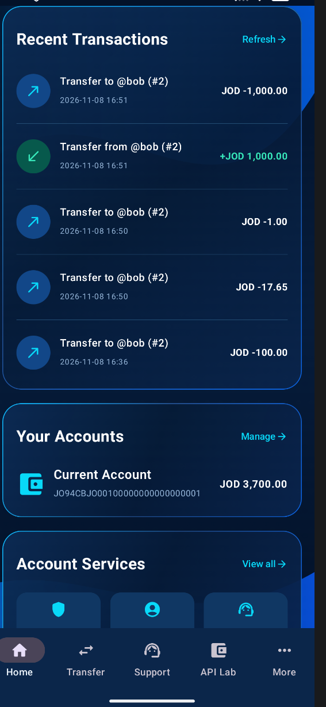
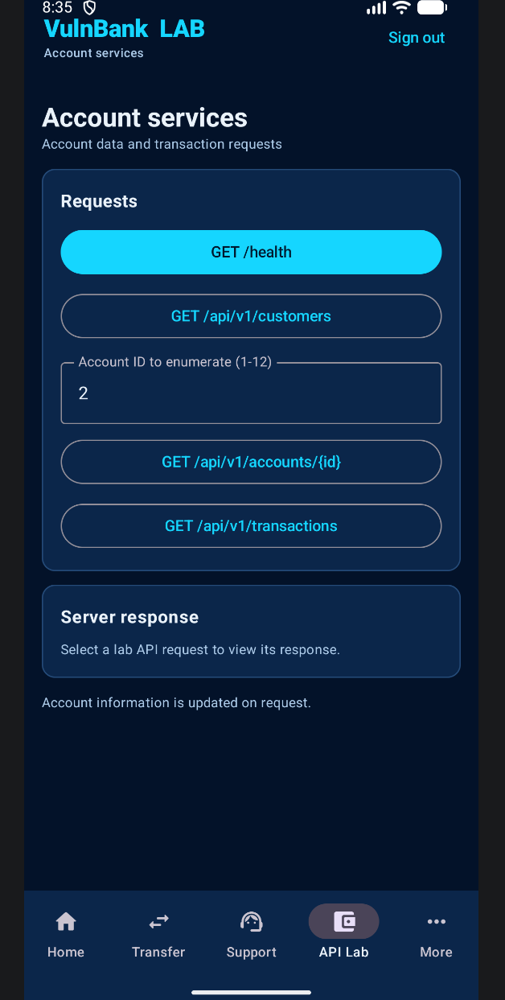

# 🏦 VulnBank LAB
### Vulnerable Android Banking Application | Mobile & API Penetration Testing

**Created by SHAMS SAMARA**

VulnBank LAB is an intentionally vulnerable Android banking application designed for hands-on mobile security research, API penetration testing, and cybersecurity education.

The project simulates a modern mobile banking environment, combining a premium Android interface with an intentionally insecure backend and realistic banking workflows.

It allows security students, penetration testers, and researchers to investigate vulnerabilities such as SQL Injection, Broken Object Level Authorization (BOLA/IDOR), Stored XSS, insecure API authentication, and unauthorized money transfers.

> ⚠️ **SECURITY WARNING — LOCAL TRAINING ONLY**
>
> VulnBank LAB is intentionally insecure. All users, accounts, balances, credentials, transactions, and API keys are fictional.
>
> Do not expose the vulnerable backend to the public internet or use this project with real financial information.

---


## 📱 Application Screenshots

### Login & Dashboard
| Login Screen | Banking Dashboard |
|:---:|:---:|
|  |  |

### Money Transfer & Transactions
| Transfer Money | Transaction History |
|:---:|:---:|
|  |  |

### API Security Lab
<p align="center">
  
</p>

Explore account endpoints, inspect API responses, and practice
mobile and API penetration testing in an isolated lab.


## ✨ Features

### Premium Android Banking Interface

Built using **Kotlin and Jetpack Compose**, featuring:

- Modern dark navy and electric-blue banking design
- Animated application splash screen
- Smooth navigation transitions
- Custom loading animations and refresh indicators
- User authentication interface
- Banking dashboard and account balance overview
- Money transfer interface
- Searchable recipient directory
- Transaction history
- Customer support interface
- API security laboratory
- Professional creator signature: **SHAMS SAMARA**

### Banking Simulation

The application includes fictional banking data and transactions:

- 12 synthetic banking customers
- Individual accounts and balances in JOD
- Demo user authentication
- Account information
- Transaction records
- Customer support tickets
- Recipient selection using full names, usernames, and account IDs
- Transfers between fictional accounts

Example recipient:

`Bob Smith · @bob · Account #2`

---

## 🛠️ Technology Stack

| Component | Technology |
|---|---|
| Android application | Kotlin |
| User interface | Jetpack Compose |
| Backend | Kotlin Ktor |
| Database | PostgreSQL |
| Local deployment | Docker Compose |
| HTTP client | OkHttp |
| HTTP interception | Burp Suite |
| Offline mobile database | SQLite |
| Build system | Gradle |

---

## 🏗️ Architecture

### Local Penetration Testing Environment

```text
              Android Emulator
              VulnBank LAB App
                      |
                      | HTTP Requests
                      v
             Burp Suite Proxy
               10.0.2.2:8081
                      |
                      v
                Ktor Backend
               127.0.0.1:8080
                      |
                      v
                 PostgreSQL
                Docker Network
```

The Android application uses an explicit HTTP proxy to allow requests and responses to be inspected and modified through Burp Suite.

The backend and database expose their host ports on the Windows loopback interface, keeping the lab isolated from external networks.

### Connection Configuration

| Service | Address |
|---|---|
| Android Emulator → Burp | `10.0.2.2:8081` |
| Burp Suite Listener | `127.0.0.1:8081` |
| Ktor Backend | `http://127.0.0.1:8080` |
| PostgreSQL | `127.0.0.1:5433` |

`10.0.2.2` is the Android Emulator's special alias for the host computer.

The current lab uses HTTP for direct interception and analysis.

---

## 📁 Project Structure

```text
VulnBankLab/
│
├── app/
│   └── src/
│       ├── main/
│       │   ├── java/com/vulnbank/lab/
│       │   │   ├── network/
│       │   │   ├── security/
│       │   │   └── ui/
│       │   └── res/
│       │
│       └── offline/
│
├── server/
│   └── src/main/kotlin/
│
├── db/
│   └── init.sql
│
├── docs/
│
├── scripts/
│
├── compose.yaml
├── build.gradle.kts
├── settings.gradle.kts
└── README.md
```

**Main components:**

- `app/` — Android application and user interface
- `server/` — Ktor backend and vulnerable API endpoints
- `db/` — PostgreSQL database schema and synthetic records
- `docs/` — Security exercises and API documentation
- `scripts/` — Local environment and validation utilities
- `compose.yaml` — Docker services and networking

---

## ⚙️ Requirements

To run the complete penetration-testing environment:

- Windows 10/11
- Android Studio and Android SDK
- Android Emulator
- Java 17 or newer
- Docker Desktop with Docker Compose
- Burp Suite
- Python 3 (optional, for API validation)

Additional tools such as JADX, APKTool, and ADB can be used for Android application analysis.

Internet access may be required during the initial installation of Gradle and Android dependencies.

---

## 🚀 Getting Started

### 1. Clone the Repository

```bash
git clone https://github.com/YOUR_USERNAME/VulnBankLab.git
cd VulnBankLab
```

Replace `YOUR_USERNAME` with your GitHub username.

### 2. Start PostgreSQL and Ktor

Open PowerShell in the project directory:

```powershell
docker compose up -d --build
```

Verify the services:

```powershell
docker compose ps
```

Both the database and backend should be running.

### 3. Verify the Backend

```powershell
curl.exe --noproxy "*" http://127.0.0.1:8080/health
```

Expected result includes:

```json
{
  "status": "ok",
  "labMode": true
}
```

You can also run the included validation script:

```powershell
python .\scripts\verify_update.py
```

### 4. Configure Burp Suite

Open Burp Suite and navigate to:

**Proxy → Proxy Settings → Proxy Listeners**

Configure an HTTP listener:

```text
Bind Address: 127.0.0.1
Port: 8081
```

Keep request interception disabled for normal application usage.

Do not configure a host or port redirect on this listener.

The Android application sends HTTP requests through this proxy, allowing traffic inspection using Burp's HTTP history and Repeater.

### 5. Run the Android Application

1. Open the project root in Android Studio.
2. Allow Gradle to synchronize.
3. Start an Android Emulator.
4. Select the appropriate application run configuration.
5. Build and run the application.

**Demo credentials:**

```text
Username: alice
Password: password123
```

Once authenticated, explore the dashboard, account information, transfers, support tickets, and API testing features.

---

## 🔐 Vulnerability Laboratory

VulnBank includes deliberately insecure application and backend functionality.

### 1. SQL Injection

**Endpoint:**

`POST /api/v1/auth/login`

The lab contains deliberately insecure username handling in its authentication logic.

Example test input:

```sql
' OR 1=1 --
```

**Learning objectives:**

- Understand SQL Injection in authentication workflows
- Observe manipulated database queries
- Investigate authentication bypass
- Learn why parameterized queries are necessary

### 2. Broken Object Level Authorization (BOLA / IDOR)

**Endpoints:**

```http
GET /api/v1/accounts/2
GET /api/v1/transactions?account_id=2
```

The backend deliberately lacks appropriate object ownership enforcement.

**Learning objectives:**

- Identify missing object-level access control
- Test unauthorized access to fictional accounts
- Understand API authorization weaknesses

### 3. Unauthorized Money Transfers

**Endpoint:**

`POST /api/v1/transfers`

The transfer feature allows fictional funds to move between banking accounts.

A deliberately missing sender-ownership verification enables testing of authorization weaknesses.

**Learning objectives:**

- Manipulate transfer requests through Burp Suite
- Investigate unauthorized source-account selection
- Understand business logic vulnerabilities
- Learn how backend transaction authorization should work

### 4. Stored Cross-Site Scripting (XSS)

**Feature:** Customer Support

The application intentionally renders untrusted HTML in a WebView.

Example test payload:

```html
<script>alert("XSS");</script>
```

**Learning objectives:**

- Understand stored XSS
- Analyze unsafe HTML rendering
- Observe JavaScript execution in embedded WebViews
- Explore secure handling of untrusted content

### 5. Hardcoded API Key

**Endpoint:**

`GET /api/v1/customers`

Demo API key:

```text
VULNBANK_LAB_KEY_123
```

**Learning objectives:**

- Analyze credentials embedded in mobile applications
- Inspect application resources and source code
- Understand why client-side API secrets cannot be trusted

### 6. Insecure Client-Side Security Controls

The application includes intentionally weak security logic for educational analysis.

The lab demonstrates why authorization and other critical security decisions must not rely exclusively on the Android client.

---

## 📡 API Reference

| Method | Endpoint | Description |
|---|---|---|
| GET | `/health` | Backend health status |
| POST | `/api/v1/auth/login` | Demo authentication |
| GET | `/api/v1/accounts/{id}` | Account information |
| GET | `/api/v1/transactions?account_id={id}` | Transaction history |
| GET | `/api/v1/recipients` | Recipient directory |
| POST | `/api/v1/transfers` | Simulated money transfers |
| GET | `/api/v1/customers` | Customer API |
| POST | `/api/v1/support` | Submit support ticket |
| GET | `/api/v1/support` | Retrieve support tickets |

For more information, see:

- `docs/API_REFERENCE.md`
- `docs/LAB_EXERCISES.md`
- `docs/TRANSFER_BURP_AR.md`
- `docs/BURP_NO_CERT_AR.md` (the existing HTTP proxy setup guide)

---

## 📱 Offline Android Demo

VulnBank also includes an optional offline-oriented Android demo for presentations and standalone mobile use.

This edition is intended to run directly on an Android phone without requiring a running Docker backend.

**Offline edition characteristics:**

- Local SQLite database
- Fictional user accounts and balances
- Local authentication and banking workflows
- Simulated money transfers
- Persistent local demo data
- Premium Android interface

Build the offline APK using:

```powershell
.\gradlew.bat :app:assembleOfflineDebug
```

The expected output is:

```text
app/build/outputs/apk/offline/debug/app-offline-debug.apk
```

**Important:** The Offline Demo is separate from the HTTP API penetration-testing environment. Network-based API testing through Burp Suite requires the Ktor backend version.

The offline database starts with synthetic demo records and does not automatically synchronize with PostgreSQL.

---

## 🔄 Daily Lab Startup

If Docker Desktop is configured to launch with Windows and the containers use:

```yaml
restart: unless-stopped
```

PostgreSQL and Ktor can automatically restart when the Docker engine becomes available.

For manual startup:

```powershell
docker compose up -d
```

Then open Burp Suite and the Android Emulator.

There is no need to rebuild Docker images every time unless the backend code or configuration has changed.

To stop the lab:

```powershell
docker compose stop
```

---

## 🗄️ Database Management

PostgreSQL uses a persistent Docker volume named `dbdata`.

Normal service restarts preserve fictional users, balances, transfers, and support tickets.

To stop and remove project containers without deleting the database volume:

```powershell
docker compose down
```

To reset the lab database:

```powershell
.\scripts\reset_lab.ps1
```

> **Warning:** Resetting the database destroys previously stored lab transactions and tickets. Use this only when a fresh training environment is required.

---

## 🛡️ Security Lessons

| Vulnerability | Production Security Principle |
|---|---|
| SQL Injection | Use parameterized SQL queries |
| Stored XSS | Safely encode and sanitize untrusted content |
| BOLA / IDOR | Enforce server-side object ownership |
| Transfer authorization bypass | Verify ownership and authorization before transfers |
| Hardcoded API keys | Avoid trusting secrets embedded in mobile applications |
| Client-side authentication weaknesses | Enforce authentication on the backend |
| Insecure token handling | Use secure token management and storage |

The application is intentionally insecure so these weaknesses can be studied in a controlled environment.

---

## ⚠️ Responsible Usage

This repository is provided exclusively for:

- Cybersecurity education
- Mobile application security research
- API penetration-testing practice
- Secure coding demonstrations
- Local security labs and academic projects

**Do not deploy VulnBank LAB as a production banking application.**

Do not connect it to real banking services, financial accounts, or public-facing infrastructure.

All included financial information is fictional.

---

## 👨‍💻 Author

**SHAMS SAMARA**

*Cybersecurity | Mobile Security | API Penetration Testing*

Developed as a practical cybersecurity training project to demonstrate mobile application vulnerabilities, insecure backend implementations, and realistic banking security scenarios.

**VulnBank LAB — Learn by Testing. Understand by Exploiting. Secure by Design.**

---

**Disclaimer:** VulnBank LAB is an intentionally vulnerable educational application. The author assumes no responsibility for misuse or deployment outside an authorized testing environment.
## Copyright & Ownership

**© 2026 Shams Samara. All Rights Reserved.**

VulnBank LAB is an educational cybersecurity project developed by Shams Samara.

All original source code, application designs, graphics, and documentation are protected by applicable copyright laws.

No permission is granted to reproduce, modify, redistribute, or commercially exploit the original project without prior written authorization from the copyright holder.

Third-party components remain subject to their respective licenses.

**Created by SHAMS SAMARA**