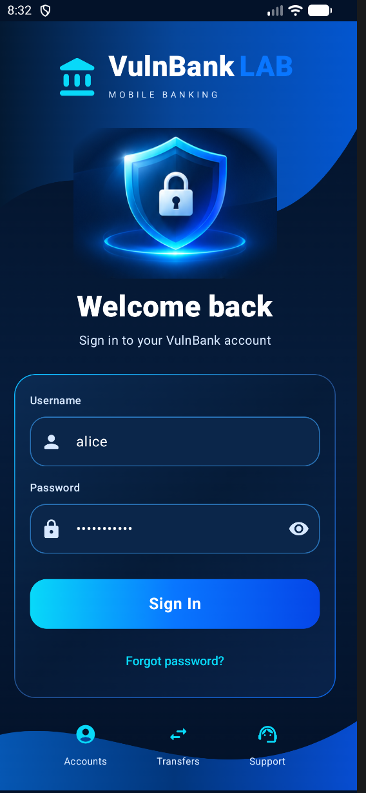
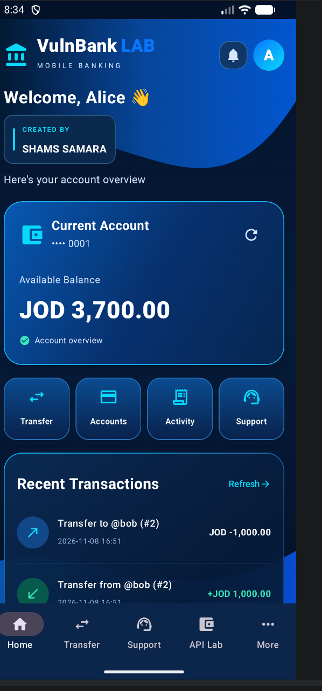
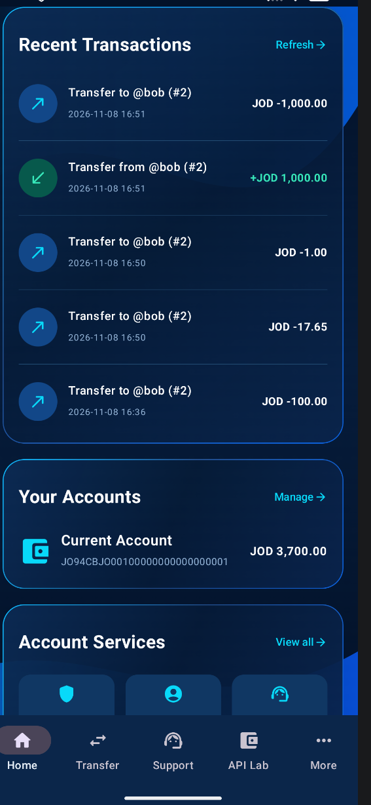
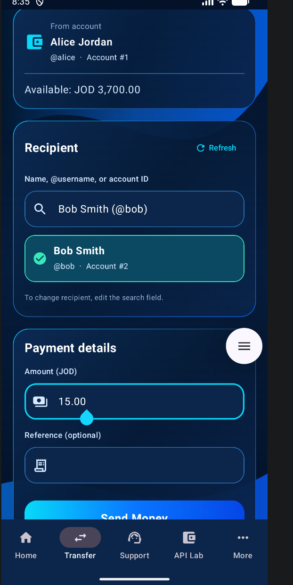
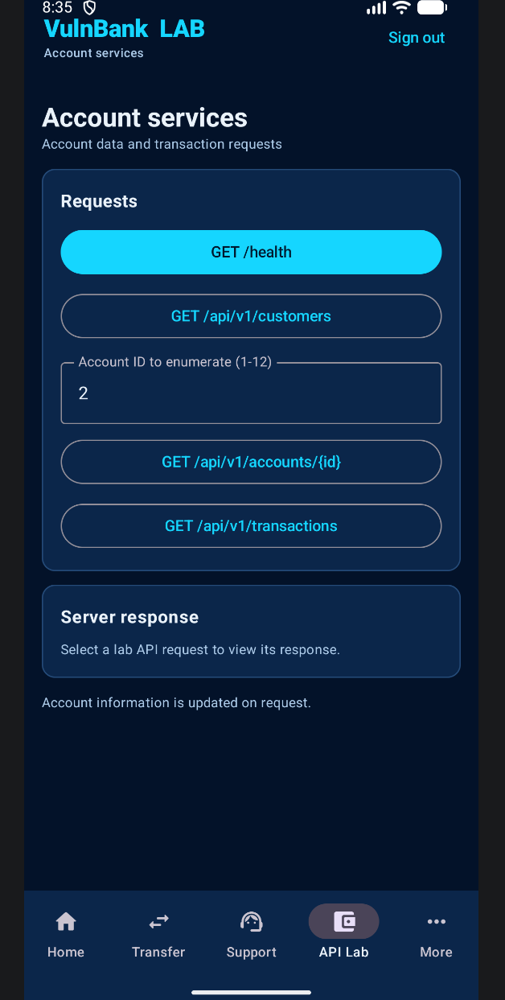

## 📱 Application Screenshots

A visual overview of the **VulnBank LAB** Android application. All accounts, balances, and transactions shown are **synthetic training data**.

| Login | Dashboard |
|:---:|:---:|
|  |  |
| Premium mobile sign-in | Account overview and quick actions |

| Transaction History | Transfer Money |
|:---:|:---:|
|  |  |
| Review synthetic activity | Select a recipient and submit a simulated transfer |

| API Security Lab |
|:---:|
|  |
| Explore deliberately vulnerable API endpoints |

> **Security notice:** VulnBank LAB is an intentionally vulnerable application for authorized, isolated cybersecurity training only. No real financial data is used.
